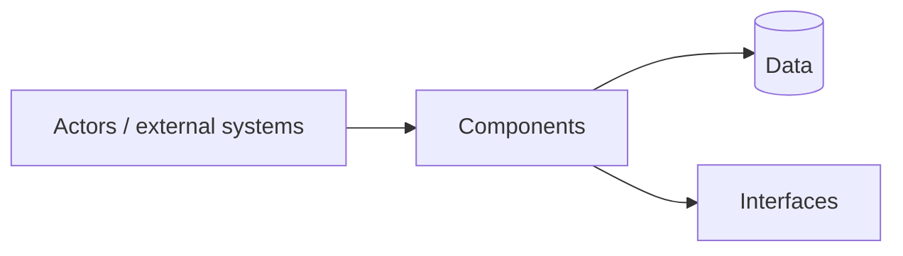

# <Project>

How the system is built. `DECISIONS.md` overrules this file wherever they disagree. Cite decision codes (`B2`) instead of restating the choice or its reason. Delete sections that don't apply.



Keep the diagram in sync with sections B to F: a one-glance summary of who uses the system, what it is made of and where state lives. Section C has the detailed diagram.

## A. Purpose and scope

<What it does and for whom, in one or two sentences.>

**Goals**
- <outcome>

**Non-goals**
- <what it deliberately does not do>

## B. Context

Who and what the system interacts with.

| Actor / external system | Direction | Interface |
|---|---|---|
| <user, service, device> | in / out / both | <protocol, API, UI> |

## C. Components

<Diagram (Mermaid or ASCII) showing components and their connections.>

| Component | Responsibility | Depends on | Owns (data/state) |
|---|---|---|---|
| <name> | <one sentence> | <components> | <what only it writes> |

## D. Key flows

One short numbered sequence per important path, naming the components involved.

**<Flow name>**
1. <actor> → <component>: <what happens>
2. <component> → <component>: <what happens>

## E. Data

| Entity | Fields that matter | Stored in | Lifetime |
|---|---|---|---|
| <name> | <key fields, invariants> | <where> | <retention> |

## F. Interfaces and contracts

Boundaries other code or systems rely on: APIs, events, file formats, CLI. Link to the schema or spec file rather than copying it.

| Interface | Kind | Spec location |
|---|---|---|
| <name> | HTTP / event / CLI / file | `<path>` |

## G. Stack

| Need | Choice | Decision |
|---|---|---|
| <need> | <choice> | <code> |

## H. Quality targets

Measurable, so a test or check can verify them.

| Attribute | Target | How checked |
|---|---|---|
| <latency, memory, availability, security> | <number or rule> | <test, benchmark, CI job> |

## I. Constraints

<Non-negotiables: platform, compliance, budget, offline use, licensing.>

## J. Repository layout

```
<dir>/   <what lives here>
```
