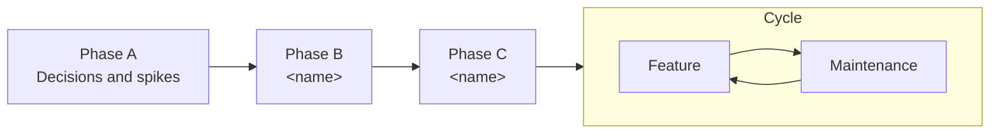

# Roadmap

Planned work, in order. `DECISIONS.md` overrules this file wherever they disagree. Phases are lettered (Phase A, Phase B, and so on) and match decision codes. A phase starts only when its decisions are Decided.

Keep the diagram in sync with the headings below: one node per phase, in order, then the cycle.

**Task format:** `- [ ] <task> (<codes>). Done when: <check>`
- Codes are the decisions the task depends on.
- The check is something the agent can run or observe: a command, a test, a visible behavior.
- A task fits one session and one reviewable diff. If it doesn't, split it.
- Tasks run top to bottom. `[P]` after the checkbox marks a task that can run in parallel with its neighbors because it touches different files.

## Phase A: Decisions and spikes

**Goal:** settle what blocks Phase B.
**Exit:** every A and B row in `DECISIONS.md` is Decided.

- [ ] <spike or question to settle> (A1). Done when: <finding recorded in the DECISIONS.md row>

## Phase B: <name>

**Goal:** <the capability that exists at the end, in one sentence>.
**Exit:** <observable result that proves the goal, such as a demo, an end-to-end test or a metric>.
**Out of scope:** <what is tempting but belongs later>.

- [ ] <task> (B1). Done when: <command, test or observable behavior>
- [ ] [P] <task> (B1). Done when: <check>

## Phase C: <name>

**Goal:**
**Exit:**

- [ ] <task> (<codes>). Done when: <check>

## Cycle: feature and maintenance

No end state. Once the planned phases are done, work repeats this loop. Each turn is a small phase of its own: new decisions first, then tasks.

**Feature turn**
1. Add the idea as a Question row in `DECISIONS.md`. Triage it to TBD, Inspect or Decided.
2. When its rows are Decided, add tasks here under a new lettered phase, in the usual task format.
3. Build, verify, and tick each task only when its check passes.

**Maintenance turn** (on a regular schedule, such as monthly or per release)
- [ ] Dependencies reviewed and upgraded where needed (<codes>). Done when: <lockfile updated, tests pass>
- [ ] Bugs and incidents triaged (<codes>). Done when: <each has a task or a Decided won't-fix>
- [ ] Docs match reality (<codes>). Done when: <no Decided row contradicts the code or `ARCHITECTURE.md`>
- [ ] Stale rows closed or reopened (<codes>). Done when: <no TBD or Inspect row older than one cycle>
